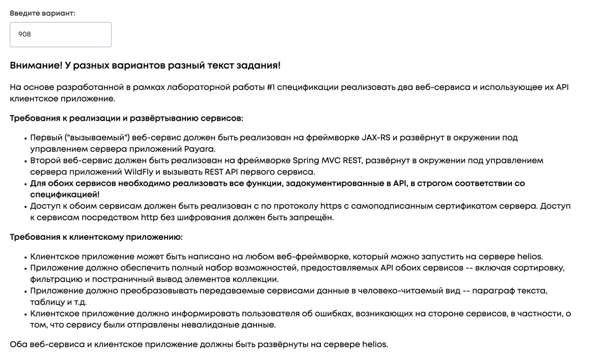

# SOA Labs: Movies + Oscars (варианты 67105 / 908)

Учебный проект из двух лабораторных ИТМО по курсу «Сервис-ориентированная архитектура»:

- **Лаба №1** — OpenAPI-спецификации двух сервисов ([moviesApi.yaml](moviesApi.yaml), [oscarApi.yaml](oscarApi.yaml)) + интерактивная документация Swagger UI.
- **Лаба №2** — реализация обоих сервисов и клиентского SPA-приложения, развёрнутые через docker compose с HTTPS на самоподписанных сертификатах собственного мини-CA.

Всё разворачивается одной командой:

```bash
docker compose -f deploy/docker-compose.yml up --build -d
# затем
open https://localhost:3000
```

---

## Содержание

1. [Архитектура](#архитектура)
2. [Состав репозитория](#состав-репозитория)
3. [Сервис movies-service (JAX-RS, Payara)](#1-movies-service--jax-rs-на-payara)
4. [Сервис oscars-service (Spring MVC REST, WildFly)](#2-oscars-service--spring-mvc-rest-на-wildfly)
5. [Фронтенд (React SPA + nginx)](#3-фронтенд--react-spa--nginx)
6. [Swagger UI](#4-swagger-ui)
7. [PostgreSQL](#5-postgresql)
8. [Как деплоится каждый контейнер](#как-деплоится-каждый-контейнер)
9. [Как фронтенд связывается с бэкендом](#как-фронтенд-связывается-с-бэкендом)
10. [Как работают сертификаты](#как-работают-сертификаты)
11. [Запуск и проверка](#запуск-и-проверка)
12. [Справочник API](#справочник-api)
13. [Особенности и подводные камни](#особенности-и-подводные-камни)

---

## Архитектура

Пять контейнеров в одной docker-сети проекта:

```
                    ┌──────────────────────────────────────────────────┐
   браузер ────────►│  frontend (nginx :443, публикуется как :3000)    │
   https://         │                                                  │
   localhost:3000   │  • статика SPA (React + Vite)                    │
   сертификат       │  • reverse proxy с проверкой сертификатов:       │
   payara.crt       │                                                  │
                    │    /docs  ────► swagger-ui:8080   (HTTP, внутри) │
                    │    /movies ──► https://payara:8181   ┐ verify    │
                    │    /oscar ───► https://wildfly:8443  ┘ по ca.crt │
                    └───────────────┬───────────────────┬──────────────┘
                                    │                   │
                     ┌──────────────▼──────┐   ┌────────▼─────────────┐
                     │  payara :8181       │◄──│  wildfly :8443       │
                     │  movies-service     │   │  oscars-service      │
                     │  JAX-RS, только     │◄──┤  JobWorker: джобы из  │
                     │  HTTPS (HTTP :8080  │   │  своей БД, команды по │
                     │  выключен)          │   │  internal-API (HTTPS, │
                     │  context root /     │   │  X-Internal-Token,    │
                     │  /internal/operations│  │  доверие: ca.crt в    │
                     └──────────┬──────────┘   │  truststore JVM)      │
                                │              └───────┬───────────────┘
                     ┌──────────▼──────────┐   ┌───────▼───────────────┐
                     │  postgres :5432     │   │  oscars-postgres:5432 │
                     │  БД movies          │   │  БД джоб oscars       │
                     └─────────────────────┘   └───────────────────────┘
```

Ключевые свойства стенда:

- **Оба сервиса доступны только по HTTPS** — HTTP-листенеры (8080) у Payara и WildFly выключены на этапе конфигурации. Требование лабы «доступ по http запрещён» выполняется на уровне серверов приложений, а не фаерволом.
- **Единая точка входа для пользователя — nginx** (`https://localhost:3000`). SPA, Swagger UI и оба API живут в одном origin, поэтому CORS не нужен вовсе.
- **Мини-PKI**: собственный корневой CA (`ca.crt`) подписывает по одному серверному сертификату для каждого узла TLS (payara, wildfly, фронтенд). Один и тот же корень доверия используют nginx (проверка апстримов) и JVM WildFly (проверка payara при исходящих вызовах).
- **Второй сервис вызывает первый по REST**: oscars-service оперирует фильмами только через API movies-service — публичный (то, что в `moviesApi.yaml`) и служебный internal-API (`internalApi.yaml`, аутентификация по заголовку `X-Internal-Token`). Это и есть «сервис-ориентированность» лабы.

## Состав репозитория

```
soa/
├── pom.xml                  # родительский Maven-модуль (movies-service, oscars-service)
├── moviesApi.yaml           # OpenAPI-спека первого сервиса (источник моделей movies-service)
├── oscarApi.yaml            # OpenAPI-спека второго сервиса
├── movies-service/          # JAX-RS + Payara, WAR movies.war
├── oscars-service/          # Spring MVC REST + WildFly, WAR oscar.war
│   ├── Dockerfile           # ⚠️ устаревший HTTP-only вариант, compose его НЕ использует
│   └── README.md            # (описывает ту старую схему — см. deploy/wildfly/Dockerfile)
├── frontend/                # React + Vite SPA, собирается в nginx-образ
│   ├── nginx.conf           # TLS-терминация + reverse proxy /movies, /oscar, /docs
│   ├── Dockerfile
│   └── src/                 # App.tsx — всё приложение в одном файле
└── deploy/
    ├── docker-compose.yml   # весь стек
    ├── postgres/init.sql    # DDL таблицы movie
    ├── payara/
    │   ├── Dockerfile       # сборка WAR + образ Payara
    │   ├── post-boot-commands.asadmin
    │   └── entrypoint.sh    # подстановка keystore из секрета
    ├── wildfly/
    │   ├── Dockerfile
    │   ├── configure.cli    # Elytron/Undertow: HTTPS on, HTTP off
    │   └── entrypoint.sh
    └── certs/out/           # сгенерированные ключи/сертификаты (в .gitignore!)
```

---

## 1. movies-service — JAX-RS на Payara

**Стек**: Jakarta EE 10 (JAX-RS / Jersey в составе Payara), JPA (Hibernate), JSON-B, Bean Validation. Java 17, packaging WAR (`movies.war`), context root `/`.

Исходники: [`movies-service/src/main/java/ru/itmo/movies/`](movies-service/src/main/java/ru/itmo/movies/)

### Модели генерируются из OpenAPI

В [`movies-service/pom.xml`](movies-service/pom.xml) подключён `openapi-generator-maven-plugin`: на этапе `generate-sources` он читает [`moviesApi.yaml`](moviesApi.yaml) (генератор `jaxrs-jersey`, только модели — `generateApis=false`) и создаёт классы пакета `ru.itmo.movies.model` (`Movie`, `MovieInput`, `MovieFilter`, `MoviePage`, перечисления…) с аннотациями JSON-B и Bean Validation. Поэтому:

- контракт сервиса и его Java-модель не могут разъехаться — модель буквально производится из спеки;
- при изменении `moviesApi.yaml` достаточно пересобрать модуль, классы перегенерируются.

Сгенерированные классы лежат в `target/generated-sources/openapi` и в git не хранятся.

### REST-ресурсы

| Класс | Что делает |
|---|---|
| `MoviesApplication` | `@ApplicationPath("/")` — входная точка JAX-RS |
| `api/MovieResource` | базовый CRUD: `POST /movies`, `GET/PUT/DELETE /movies/{id}` |
| `api/MovieFilterResource` | `POST /movies/filter` — выборка с фильтрацией/сортировкой/пагинацией: фильтр (`MovieFilter`, любое сочетание полей) приходит **телом** JSON, `page`/`size`/`sort` — query-параметрами |
| `api/MovieSpecialResource` | «дополнительные» операции лабы: `GET /movies/average-budget`, `DELETE /movies/by-mpaa-rating`, `DELETE /movies/by-screenwriter` |
| `service/MovieService` | бизнес-логика и транции JTA |
| `repository/*` | `MovieEntity` + репозиторий на JPQL/Criteria, парсинг `sort` (`SortOrder.parse("id,asc")`) |
| `web/*` | фильтры и ExceptionMappers (см. ниже) |

### Хранение: PostgreSQL через JTA-датасорс

- [`persistence.xml`](movies-service/src/main/resources/META-INF/persistence.xml) объявляет persistence-unit `moviesPU` на JTA-датасорс `jdbc/MoviesDS` (пул создаётся asadmin-командами при старте Payara, см. [деплой](#payara-movies-service)).
- Схема БД создаётся **не** Hibernate'ом (`schema-generation=none`), а declaratively — [`deploy/postgres/init.sql`](deploy/postgres/init.sql) выполняется контейнером postgres при первом старте тома. Ограничения целостности из задания продублированы на уровне БД (CHECK на `coord_x > -130`, `coord_y <= 388`, `oscars_count >= 0`, «screenwriter весь целиком или никак» и т.д.).

### Обработка ошибок

Единый формат ошибки — JSON `{message, code, details: [{field, message}]}` (`web/ErrorResponses`). Набор `ExceptionMapper'ов` переводит исключения в осмысленные коды:

| Ситуация | Код | Маппер |
|---|---|---|
| Нарушены ограничения полей (Bean Validation) | `422` | `ConstraintViolationMapper` |
| Тело — битый JSON | `400` | `MalformedJsonMapper` |
| `Content-Type` не `application/json` | `415` | `NotSupportedMapper` |
| `Accept` не допускает JSON | `406` | `NotAcceptableMapper` |
| Бизнес-ошибки (`ApiException`: не найдено, конфликт…) | `404` и др. | `ApiExceptionMapper` |
| Всё остальное | `500` | `FallbackMapper` |
| Тело запроса больше 1 МБ | `413` | `RequestLimitFilter` (PreMatching-фильтр) |

## 2. oscars-service — Spring MVC REST на WildFly

**Стек**: Spring Boot 3.5 (`spring-boot-starter-web`, без стартера БД), **упакован как WAR** (`finalName=oscars`) и развёрнут в WildFly — то есть это Spring MVC REST в сервере приложений, как требует задание, а не standalone-джарка с встроенным Tomcat. Java 17.

Исходники: [`oscars-service/src/main/java/ru/itmo/oscar/`](oscars-service/src/main/java/ru/itmo/oscar/)

- `OscarApplication extends SpringBootServletInitializer` — точка входа WAR-деплоя.
- Имя файла `oscar.war` задаёт context root: все эндпоинты живут под **`/oscar`** (требование лабы).
- Модели (`model/`) — hand-written record'ы, повторяющие `oscarApi.yaml`.
- `jboss-deployment-structure.xml` выключает подсистему logging WildFly, чтобы логи не ломались конфликтом с логгером Spring.
- Джобы **персистентны**: их статусы хранятся в собственной БД сервиса (`oscars-postgres`, схема — `oscars-service/src/main/resources/schema.sql`), поэтому перезапуск контейнера их не теряет — «недоделанная» джоба доигрывается после старта.

### Вызов первого сервиса: `client/MoviesClient`

`config/MoviesClientConfig` собирает Spring `RestClient` поверх JDK `HttpClient`:

- base URL — из переменной окружения `MOVIES_SERVICE_URL` (в compose это `https://payara:8181`);
- таймауты: connect `3s` (`MOVIES_CONNECT_TIMEOUT`), read `30s` (`MOVIES_READ_TIMEOUT`);
- HTTPS «просто работает», потому что `ca.crt` импортирован в truststore JVM образа WildFly (см. [деплой](#wildfly-oscars-service)).

Массовые операции выполняются через **служебный internal-API** (спека — [`internalApi.yaml`](internalApi.yaml)): `POST /internal/operations` с заголовком `X-Internal-Token` (env `MOVIES_INTERNAL_TOKEN`, одинаковый у обоих сервисов) и телом `{jobId, type: REWARD_R|RESET_BY_GENRE, arguments}`. movies-service выполняет команду **атомарно в одной транзакции** и идемпотентно: повтор с тем же `jobId` возвращает уже сохранённый результат, а не выполняет её заново. Любая ошибка ответа заворачивается в `MoviesServiceException("Сервис movies вернул HTTP …: <тело до 500 символов>")` — текст потом доезжает до пользователя через статус джобы.

### Бизнес-операции (`service/OscarService`)

- `REWARD_R` — всем фильмам с `mpaaRating=R` по +1 «Оскару».
- `RESET_BY_GENRE(genre)` — обнулить `oscarsCount` у всех фильмов сценаристов, снявших хоть один фильм в указанном жанре.

Обе операции — команды для internal-API; сами изменения фильмов выполняет movies-service.

### Асинхронные джобы: 202 Accepted + опрос статуса

Операции массовые (N вызовов PUT по сети), поэтому API спроектировано асинхронным:

1. `POST /oscar/movies/reward-r` (или `/oscar/movies/reset-oscars-by-genre/{genre}`) не выполняет работу, а ставит джобу и отвечает **`202 Accepted`** c телом `{jobId: UUID, statusUrl: "/oscar/jobs/<uuid>/status"}`.
2. `service/JobWorker` по расписанию (`@Scheduled`, раз в секунду) забирает из БД свободную джобу (claim с lease-арендой) и выполняет её через internal-API; при сетевом сбое — повтор с тем же `jobId`, результат фиксируется транзакционно вместе с изменением фильмов. Перезапуск посреди операции не теряет и не дублирует её.
3. `GET /oscar/jobs/{job-id}/status` возвращает `{jobId, status: PENDING|RUNNING|COMPLETED|FAILED, result: {updatedCount} | {errorMessage}}`. Несуществующий/некорректный UUID → 404/400.
4. Фронтенд (и любой клиент) опрашивает statusUrl, пока не увидит терминальный статус.

## 3. фронтенд — React SPA + nginx

**Стек**: React 18 + TypeScript + Vite, без UI-библиотек (иконки `lucide-react`). Всё приложение — [`frontend/src/App.tsx`](frontend/src/App.tsx).

Возможности (полный набор API обоих сервисов, как требует лаба):

- таблица фильмов: сортировка по любой колонке, разворачиваемые строки с деталями, пагинация с выбором размера страницы;
- панель фильтров: все поля `MovieFilter` (id-список, подстрока названия, диапазоны координат/оскаров/бюджета, интервал дат создания, жанры, MPAA, все поля сценариста и его локации);
- создание/редактирование/удаление фильмов (форма с клиентской валидацией, дублирующей серверную, и понятными сообщениями);
- «дополнительно»: средний бюджет, удаление по MPAA-рейтингу, удаление одного фильма сценариста;
- вкладка «Операции»: запуск двух оскаровских операций, журнал джоб, ручная проверка статуса по UUID;
- ошибки сервера показываются тостами: клиент читает JSON `{message, details:[{field,message}]}` и склеивает из него человекочитаемое сообщение (`api()` в начале `App.tsx`).

Важно: SPA ходит в API **только по относительным путям** (`fetch('/movies/...')`, `fetch('/oscar/...')`) — никакие адреса бэкендов во фронтенде не зашиты. Куда реально летит запрос, решает nginx (следующий раздел).

## 4. Swagger UI

Контейнер `swagger-ui` — официальный образ `swaggerapi/swagger-ui:v5.33.1`. Оба yaml-файла монтируются прямо в html-каталог образа, а переменная `URLS` задаёт выпадающий список из двух спек («Movies Service», «Oscars Service»). Наружу Swagger UI не опубликован — он доступен только внутри docker-сети по адресу `swagger-ui:8080`, и пользователь попадает на него через nginx по пути `/docs/`.

Поскольку спеки объявляют `servers: [{url: /}]`, а nginx проксирует `/movies` и `/oscar` в той же origin, кнопка **Try it out в Swagger UI работает из коробки** — запросы уходят на тот же `https://localhost:3000` и честно проходят через TLS-проверку nginx'а.

## 5. PostgreSQL — два инстанса

**`postgres`** (база фильмов): `postgres:16-alpine`, БД/пользователь/пароль — `movies/movies/movies`. При **первой** инициализации пустого тома `pgdata` выполняется [`deploy/postgres/init.sql`](deploy/postgres/init.sql) (механизм `docker-entrypoint-initdb.d`): создаётся таблица `movie` со всеми CHECK-ограничениями. Healthcheck `pg_isready` используется compose'ом: payara не стартует, пока БД не готова. Схему таблицы операций (`V002__movie_operations.sql`) накатывает одноразовый контейнер `migrations` (psql с `ON_ERROR_STOP`), поэтому миграции применяются и к уже существующему тому.

**`oscars-postgres`** (база джоб oscars-сервиса): отдельный `postgres:16-alpine` с томом `oscars-pgdata`; схему джоб создаёт `schema.sql` самого Spring-приложения. Подключение — env `OSCARS_DB_URL` у wildfly.

---

## Как деплоится каждый контейнер

Ниже — что именно происходит при `docker compose up --build` для каждого сервиса. Все образы, кроме postgres-инстансов, migrations и swagger-ui, собираются из исходников: контекст сборки — **корень репозитория** (поэтому в `COPY` путях типа `movies-service/src` и `deploy/certs/out/...`).

### postgres

Готовый образ, ничего не собирается. Том `pgdata` переживает пересоздание контейнера; `init.sql` выполнится один раз, миграции `V002+` — при каждом `up` (идемпотентно через контейнер `migrations`). Наружу порт 5432 **не** публикуется — БД видна только внутри docker-сети.

### payara (movies-service)

Сборка — [`deploy/payara/Dockerfile`](deploy/payara/Dockerfile), два этапа:

1. **build**: `maven:3.9.9-eclipse-temurin-17` — копируются `pom.xml`, `moviesApi.yaml` (он нужен на этапе генерации моделей!) и `movies-service/pom.xml`, прогревается кэш зависимостей (`dependency:go-offline`), отдельно скачивается драйвер PostgreSQL 42.7.4, затем `mvn package` → `movies.war`.
2. **runtime**: `payara/server-full:6.2024.12-jdk17`, куда:
   - `ca.crt` импортируется в JDK `cacerts` **и** в доменный `cacerts.p12` Payara — домен доверяет сертификатам, подписанным нашим CA (нужно для исходящих HTTPS-соединений);
   - postgresql-драйвер кладётся в `domain1/lib/ext/` — так класс драйвера виден при создании JDBC-пула;
   - копируются `post-boot-commands.asadmin` и `movies.war`.

**Подстановка сертификата**: настоящий серверный ключ в образ не запекается. compose монтирует `certs/out/keystore.jks` read-only как `/run/secrets/payara.jks`, а обёртка [`deploy/payara/entrypoint.sh`](deploy/payara/entrypoint.sh) перед стартом домена копирует его в `domain1/config/keystore.p12` с владельцем `payara:payara` и правами 600, после чего запускает штатный entrypoint образа от пользователя payara.

**Конфигурация домена**: Payara-образ после старта автоматически выполняет [`deploy/payara/post-boot-commands.asadmin`](deploy/payara/post-boot-commands.asadmin):

```text
# HTTP выключаем, HTTPS включаем
set ...http-listener-1.enabled=false          # :8080 закрыт навсегда
set ...http-listener-2.enabled=true           # :8181
set ...http-listener-2.security-enabled=true  # TLS; сертификат — дефолтный alias s1as из keystore.p12

# Пул подключений к postgres + JNDI-имя для persistence.xml
create-jdbc-connection-pool --datasourceclassname=org.postgresql.ds.PGSimpleDataSource \
    --restype=javax.sql.DataSource \
    --property="serverName=postgres:portNumber=5432:databaseName=movies:user=movies:password=movies" MoviesPool
create-jdbc-resource --connectionpoolid=MoviesPool jdbc/MoviesDS

# Деплой приложения (последним шагом, когда пул уже создан)
deploy --force=true --contextroot=/ --name=movies /opt/payara/movies.war
```

Публикуются порты: `8181` (API) и `127.0.0.1:4848` (админ-консоль, только с localhost хост-машины). Переменная `JVM_ARGS` в compose ограничивает память (-Xmx256m, SerialGC) — иначе Payara съест гигабайты.

> Подъём занимает 1–2 минуты: домен стартует, потом выполняются asadmin-команды, деплой WAR'а — последняя из них.

### wildfly (oscars-service)

Сборка — [`deploy/wildfly/Dockerfile`](deploy/wildfly/Dockerfile), два этапа:

1. **build**: maven-образ собирает `oscars-service` → `oscar.war` (Spring Boot WAR).
2. **runtime**: `quay.io/wildfly/wildfly:32.0.1.Final-jdk17`, где:
   - генерируется **временный** самоподписанный ключ в `wildfly.p12` (нужен, чтобы следующая CLI-конфигурация могла сослаться на существующий файл);
   - выполняется [`deploy/wildfly/configure.cli`](deploy/wildfly/configure.cli) через `jboss-cli` в режиме embedded-сервера — конфигурирует `standalone.xml` **на этапе сборки образа**;
   - временный ключ удаляется; история изменений конфига тоже;
   - `ca.crt` импортируется в JDK `cacerts` — благодаря этому исходящий `RestClient`-клиент принимает HTTPS-сертификат payara (hostname `payara` есть в SAN);
   - `oscar.war` кладётся в `standalone/deployments/` — автодеплой; **имя файла = context root `/oscar`**;
   - права на `standalone/` возвращаются пользователю `jboss` (jboss-cli запускался от root и насоздавал root-файлов).

`configure.cli` по шагам:

```text
/subsystem=elytron/key-store=httpsKS:add(path=...wildfly.p12, ...)          # хранилище
/subsystem=elytron/key-manager=httpsKM:add(key-store=httpsKS, ...)          # ключи
/subsystem=elytron/server-ssl-context=httpsSSC:add(..., protocols=["TLSv1.2","TLSv1.3"])

# дефолтный https-listener (со старым self-signed из ApplicationRealm) пересоздаём:
# наш ssl-context + лимит тела 1 МБ (защита от огромных PUT'ов)
/subsystem=undertow/.../https-listener=https:remove()
/subsystem=undertow/.../https-listener=https:add(socket-binding=https, ssl-context=httpsSSC, max-post-size=1048576)

# HTTP (8080) удаляем — только HTTPS
/subsystem=undertow/.../http-listener=http:remove()
```

**Подстановка сертификата** — та же схема, что у Payara: compose монтирует `certs/out/wildfly.p12` как `/run/secrets/wildfly.p12`, а [`deploy/wildfly/entrypoint.sh`](deploy/wildfly/entrypoint.sh) копирует секрет в `standalone/configuration/wildfly.p12` (600, jboss) и стартует `standalone.sh` от пользователя jboss. Временный ключ из сборки нужен был только чтобы listener уже существовал в конфиге.

Переменная `MOVIES_SERVICE_URL=https://payara:8181` сообщает сервису адрес первого сервиса.

### swagger-ui

Готовый образ; спецификации монтируются из корня репозитория. Порт наружу не публикуется.

### frontend

Сборка — [`frontend/Dockerfile`](frontend/Dockerfile): в `node:22-alpine` выполняется `npm ci && npm run build` (Vite-сборка со строгой typecheck-проверкой tsc), результат `dist/` кладётся в `nginx:1.27-alpine` вместе с [`nginx.conf`](frontend/nginx.conf). compose монтирует три файла сертификатов (`ca.crt`, `payara.crt` как `server.crt`, `payara.key` как `server.key`) и публикует порт `3000 → 443`.

### Порядок запуска

```text
postgres (healthcheck pg_isready)
   └─► payara (ждёт healthy postgres; потом 1–2 минуты внутреннего старта)
         └─► wildfly (depends_on: payara)
frontend (ждёт payara, wildfly, swagger-ui)
```

`depends_on` без condition — это только порядок старта контейнеров, не готовность приложений; поэтому фронтенд и nginx в нём не полагаются на «аптайм» бэкендов, а резолвят их имена на каждый запрос (см. ниже).

---

## Как фронтенд связывается с бэкендом

### Единый origin и reverse proxy

Браузер знает один адрес — `https://localhost:3000`. Все маршруты разруливает nginx ([`frontend/nginx.conf`](frontend/nginx.conf)):

| Путь | Куда идёт запрос | Проверка сертификата апстрима |
|---|---|---|
| `/` и статика | локальная файловая система (SPA, `try_files ... /index.html` — поддержка/history-роутинга) | — |
| `/docs/` | `http://swagger-ui:8080/` (внутри docker-сети, HTTP) | — |
| `/movies` | `https://payara:8181` | да, см. ниже |
| `/oscar` | `https://wildfly:8443` | да, см. ниже |

Поскольку браузер всегда разговаривает с одним origin, **CORS не возникает вообще** — ни для SPA, ни для Try it out в Swagger UI.

### Честная проверка TLS у апстримов

Для `/movies` и `/oscar` nginx работает как **проверяющий** HTTPS-клиент:

```nginx
proxy_ssl_server_name on;                          # отправлять SNI
proxy_ssl_name payara;                             # какое имя сверять с SAN сертификата
proxy_ssl_trusted_certificate /etc/nginx/certs/ca.crt;
proxy_ssl_verify on;                               # сертификат апстрима обязан быть
proxy_ssl_protocols TLSv1.2 TLSv1.3;               # подписан нашим CA и иметь нужный SAN
```

То есть недостаточно «шифрования ради шифрования»: если кто-то подсунет nginx'у левый узел `payara` с любым валидным сертификатом не из нашего CA — соединение будет отвергнуто (502).

### Динамический резолв имён

```nginx
resolver 127.0.0.11 valid=10s ipv6=off;   # встроенный DNS docker (127.0.0.11)
set $movies_backend https://payara:8181;
location /movies { proxy_pass $movies_backend; ... }
```

`proxy_pass` через **переменную** заставляет nginx резолвить имя на каждый запрос, а не один раз при старте (и не падать, если контейнер бэкенда в этот момент перезапускается).

### Сценарии взаимодействия

- **CRUD/фильтры**: SPA → `fetch('/movies/...')` → nginx → `https://payara:8181/movies/...` → Postgres. Таблица перезагружается после каждой мутации; параллельно обновляется метрика среднего бюджета.
- **Оскаровские операции**: SPA → `POST /oscar/movies/reward-r` → nginx → wildfly → мгновенно `202 {jobId, statusUrl}`. Далее фронт опрашивает `GET /oscar/jobs/{id}/status` (с экспоненциальной задержкой и авто-восстановлением после сетевых сбоев — джоба хранится на сервере и никуда не денется), рисует статусы PENDING/RUNNING/COMPLETED/FAILED, после терминального статуса обновляет таблицу и средний бюджет; ошибка джобы показывается тостом.
- **Ошибки валидации**: сервис отвечает `422` c `{message, details:[{field,message}]}`; `api()`-обёртка фронтенда превращает это в `ApiRequestError` с текстом «message — field: message; …», который показывается пользователю. То же тело едят Swagger UI и любые другие клиенты.

### oscars-service → movies-service (внутренний вызов)

Вторая «связка» лабы — межсервисный REST-вызов, тоже по HTTPS с взаимным доверием через общий CA:

```text
wildfly (JobWorker → RestClient, JDK HttpClient)
   → POST https://payara:8181/internal/operations
     заголовок X-Internal-Token, тело {jobId, type, arguments}
   ← 200 OperationResult (идемпотентно: повтор с тем же jobId
      возвращает сохранённый результат одной транзакцией)
```

- Адрес задаётся env `MOVIES_SERVICE_URL` (в compose — `https://payara:8181`); имя хоста `payara` из docker-DNS совпадает с SAN сертификата.
- Доверие — потому что при сборке образа wildfly `ca.crt` импортирован в `cacerts` JVM: JDK-клиент проверяет цепочку payara против этого корня.
- Служебный эндпоинт `/internal/operations` **не проксируется клиентским nginx** — снаружи он недоступен, токен знают только два сервиса.
- Если movies недоступен или вернул 503, JobWorker повторяет команду с тем же `jobId`; при окончательной ошибке джоба переходит в `FAILED` с текстом `MoviesServiceException` — ошибка не теряется и видна через статус джобы.

---

## Как работают сертификаты

### Модель доверия: собственный мини-CA

Используется трёхуровневая схема из лабораторной практики:

```
                 ca.key / ca.crt  («SOA Lab Root CA», корень доверия)
                        │ подписывает
        ┌───────────────┼────────────────────────────┐
        ▼               ▼                            ▼
   payara.crt      wildfly.crt                  payara.crt (тот же —
   SAN: payara,    SAN: wildfly,                используется и nginx'ом
   localhost,      localhost,                   фронта как server.crt)
   домен, IP       домен, IP
        │               │                            │
   keystore.jks     wildfly.p12                server.crt + server.key
   (JKS, alias      (PKCS#12,                   ( PEM, читает nginx)
    s1as, changeit)  changeit)
```

Файлы лежат в `deploy/certs/out/` (каталог в `.gitignore` — секреты не попадают в git, на сервер передаются отдельно, например `scp`):

| Файл | Что это | Кто использует |
|---|---|---|
| `ca.key` | закрытый ключ корневого CA | только для подписания новых сертификатов |
| `ca.crt` | корневой сертификат | nginx (`proxy_ssl_trusted_certificate`), JVM wildfly и payara (`cacerts`), браузер/curl на стороне пользователя |
| `payara.crt/.key/.csr` | серверный сертификат Payara в PEM | nginx фронта (как `server.crt`/`server.key`) |
| `keystore.jks` | тот же сертификат+ключ в JKS, alias `s1as`, пароль `changeit` | монтируется в payara как `/run/secrets/payara.jks` |
| `wildfly.crt/.key/.csr` | серверный сертификат WildFly в PEM | — (исходник для p12) |
| `wildfly.p12` | сертификат+ключ в PKCS#12, пароль `changeit` | монтируется в wildfly как `/run/secrets/wildfly.p12` |
| `payara.ext`, `wildfly.ext` | списки SAN при подписании | openssl (в git **не** игнорируются — это не секрет) |

SAN у обоих сертификатов: DNS `payara`/`wildfly` (docker-имена контейнеров — именно их сверяют nginx и RestClient), DNS `localhost`, публичное доменное имя (`soa.alenaandpim.abrdns.com`) и IP сервера `31.59.126.210` — один и тот же сертификат работает и в docker-сети, и при заходе снаружи.

### Принцип «секреты не в образе»

Ни один приватный ключ не запекается в Docker-образ:

- **payara**: образ содержит только публичный `ca.crt`; keystore с ключом приходит read-only volume'ом `/run/secrets/payara.jks`, entrypoint копирует его в конфиг домена перед стартом;
- **wildfly**: аналогично через `/run/secrets/wildfly.p12`;
- **frontend**: nginx получает `server.crt/server.key/ca.crt` тоже через volume (это единственное место, где ключ лежит рядом с «публичным» контейнером; сам сертификат — копия payara'овского).

В git при этом находятся только `.ext`-файлы — сами ключи/хранилища игнорируются.

### Как это выглядит по участникам TLS

| Соединение | Клиент | Сервер | Серверный сертификат | Чем проверяет клиент |
|---|---|---|---|---|
| браузер → nginx | браузер | nginx :443 | `payara.crt` (server.crt) | доверие к `ca.crt` в ОС/браузере |
| nginx → payara | nginx | payara :8181 | `keystore.jks` (alias `s1as`) | `ca.crt` + `proxy_ssl_name payara` |
| nginx → wildfly | nginx | wildfly :8443 | `wildfly.p12` | `ca.crt` + `proxy_ssl_name wildfly` |
| wildfly → payara | RestClient (JDK HttpClient) | payara :8181 | тот же | `ca.crt` в `cacerts` JVM образа wildfly |
| swagger-ui ← браузер | браузер | nginx :443 | тот же, что у фронта | тот же CA |

### Регенерация сертификатов с нуля

Каталог `certs/out` можно воспроизвести следующими командами (проверенный набор; `payara.ext`/`wildfly.ext` уже лежат рядом):

```bash
cd deploy/certs && mkdir -p out && cd out

# 1) Корневой CA
openssl genrsa -out ca.key 2048
openssl req -x509 -new -key ca.key -sha256 -days 1825 \
  -subj "/CN=SOA Lab Root CA" -out ca.crt

# 2) Ключ + CSR + подпись для каждого сервиса (SAN — из .ext-файлов)
for s in payara wildfly; do
  openssl genrsa -out $s.key 2048
  openssl req -new -key $s.key -subj "/CN=$s" -out $s.csr
  openssl x509 -req -in $s.csr -CA ca.crt -CAkey ca.key -CAcreateserial \
    -days 825 -sha256 -extfile $s.ext -out $s.crt
done

# 3) PKCS#12 для WildFly (alias wildfly, пароль changeit)
openssl pkcs12 -export -name wildfly -inkey wildfly.key -in wildfly.crt \
  -certfile ca.crt -passout pass:changeit -out wildfly.p12

# 4) JKS для Payara (alias s1as, пароль changeit) — через временный p12
openssl pkcs12 -export -name s1as -inkey payara.key -in payara.crt \
  -certfile ca.crt -passout pass:changeit -out payara.p12
keytool -importkeystore -noprompt \
  -srckeystore payara.p12  -srcstoretype PKCS12 -srcstorepass changeit \
  -destkeystore keystore.jks -deststoretype JKS  -deststorepass changeit
rm payara.p12
```

После регенерации достаточно перезапустить стек: `ca.crt` попадает в truststore'ы при сборке образов (пересобрать: `up --build`), а серверные хранилища монтируются volume'ами на лету.

### Доверие на стороне клиента

Сертификаты самоподписанные, поэтому «из коробки» клиент их не доверяет — это ожидаемо:

- **curl**: добавлять `--cacert deploy/certs/out/ca.crt`;
- **браузер**: либо согласиться с предупреждением, либо импортировать `ca.crt` в систему (macOS: двойной клик → Связка ключей → «Всегда доверять»); после этого зелёный замок и на `localhost:3000`, и на доменном имени.

---

## Запуск и проверка

### Локально

```bash
# 0) сертификаты: если deploy/certs/out пуст — сгенерировать (см. выше)
# 1) весь стек
docker compose -f deploy/docker-compose.yml up --build -d

# 2) ждать готовности payara (1–2 минуты после старта контейнера)
docker compose -f deploy/docker-compose.yml logs -f payara
```

Проверка:

```bash
# movies напрямую (HTTPS-only, доверяем нашему CA)
curl --cacert deploy/certs/out/ca.crt https://localhost:8181/movies/average-budget

# oscars: запустить джобу и посмотреть статус
curl --cacert deploy/certs/out/ca.crt -X POST https://localhost:8443/oscar/movies/reward-r
curl --cacert deploy/certs/out/ca.crt https://localhost:8443/oscar/jobs/<jobId>/status

# HTTP закрыт у обоих сервисов — должно быть connection refused/redirect-ошибку, не 200
curl -i http://localhost:8181/movies/average-budget

# единая точка входа: SPA + Swagger UI + оба API через один origin
open https://localhost:3000
open https://localhost:3000/docs/
```

### Сборка без Docker (для разработки)

```bash
mvn clean package                        # оба WAR'а: movies.war, oscar.war
cd frontend && npm ci && npm run dev     # SPA на :5173 (нужны поднятые бэкенды+proxy)
```

### Перенос на сервер

```bash
# секреты передаём отдельно, они не в git
scp -r deploy/certs/out user@31.59.126.210:~/soa/deploy/certs/
git clone <repo> server:~/soa && cd soa
docker compose -f deploy/docker-compose.yml up --build -d
```

Сертификаты уже выпущены с SAN для домена и IP сервера, так что с сервера же работают `https://31.59.126.210:3000` и `https://soa.alenaandpim.abrdns.com:3000`.

---

## Справочник API

### movies-service (`https://...:8181`)

| Метод и путь | Назначение | Коды |
|---|---|---|
| `POST /movies` | добавить фильм (`MovieInput` в теле) | 201 / 422 / 400 |
| `GET /movies/{id}` | получить по id | 200 / 404 |
| `PUT /movies/{id}` | полное обновление | 200 / 404 / 422 |
| `DELETE /movies/{id}` | удалить | 204 / 404 |
| `POST /movies/filter?page&size&sort` | выборка: `MovieFilter` телом, сортировка `sort=field,asc\|desc`, пагинация `page`/`size` | 200 / 422 |
| `GET /movies/average-budget` | средний бюджет по коллекции | 200 |
| `DELETE /movies/by-mpaa-rating?mpaa-rating=` | удалить все с данным рейтингом | 200 (`{deletedCount}`) |
| `DELETE /movies/by-screenwriter?name=` | удалить один фильм сценариста | 204 / 404 |

### oscars-service (`https://...:8443/oscar`)

| Метод и путь | Назначение | Коды |
|---|---|---|
| `POST /movies/reward-r` | джоба: +1 оскар всем фильмам R | 202 `{jobId, statusUrl}` |
| `POST /movies/reset-oscars-by-genre/{genre}` | джоба: обнулить оскары у фильмов сценаристов указанного жанра | 202 / 400 |
| `GET /jobs/{job-id}/status` | статус джобы: `PENDING/RUNNING/COMPLETED/FAILED` + `result` | 200 / 404 |

Полная машиночитаемая спецификация — [moviesApi.yaml](moviesApi.yaml) и [oscarApi.yaml](oscarApi.yaml); человекочитаемая — Swagger UI на `/docs/`.

---

## Особенности и подводные камни

- **Apple Silicon**: образ `payara/server-full` публикуется только под `linux/amd64` — в compose для payara указан `platform: linux/amd64`; на M-чипах нужен Colima с Rosetta (`colima start --vz-rosetta`) или qemu (медленнее).
- **Память**: JVM обоих серверов ограничена через env (`-Xmx256m`, SerialGC), иначе Payara + WildFly + Postgres + nginx не влезают в скромные лимиты учебной машины.
- **Время старта payara**: WAR деплоится последней asadmin-командой после создания пула; «контейнер running» ≠ «API готов» — ждите записи в логах или просто минуту-другую.
- **Джобы персистентны**: статусы живут в БД `oscars-postgres` и переживают перезапуск контейнера (недовыполненная операция доиграется — идемпотентность гарантирует `jobId`). Изменения фильмов — в основной БД `movies`.
- **Деплой джоб последовательно**: одновременно исполняется одна массовая операция (ReentrantLock), остальные ждут в PENDING — фронт на это рассчитан и блокирует кнопки.
- **`oscars-service/Dockerfile` и `oscars-service/README.md`** — исторические артефакты эпохи «HTTP-only, без compose»; рабочий путь сборки — `deploy/wildfly/Dockerfile` (его и использует compose). Не путать.
- **Пароли**: пароли хранилищ `changeit` и реквизиты БД `movies/movies` зашиты для учебного стенда; для чего-то серьёзнее их нужно вынести в env/секреты.
- **HTTP выключен на уровне серверов** (listener'ы удалены), а не спрятан непубликацией портов: даже внутри docker-сети по HTTP сервисы недоступны.

## Задание (кратко)

<details>
<summary>Лаба №1 (вариант 67105) и Лаба №2 (вариант 908) — исходные формулировки</summary>

**Лаба 1**: OpenAPI-спецификация двух сервисов — управления коллекцией `Movie` (с вложенными `Coordinates`, `Person`, `Location`, енумами; ограничения целостности на поля) и сервиса `/oscar`, вызывающего первый. RESTful, JSON, базовый CRUD + фильтрация/сортировка/пагинация по любой комбинации полей, спец-операции (удаление по MPAA, удаление одного фильма сценариста, средний бюджет), Swagger UI с описанием всех операций.

**Лаба 2**: первый сервис — JAX-RS на Payara; второй — Spring MVC REST на WildFly, вызывает API первого; оба строго соответствуют спецификации; доступ только по HTTPS с самоподписанным сертификатом, HTTP запрещён; клиентское веб-приложение на любом фреймворке: полный набор возможностей API (включая сортировку/фильтрацию/пагинацию), человекочитаемое представление данных, информирование об ошибках сервисов, в т.ч. о невалидных данных.



</details>
